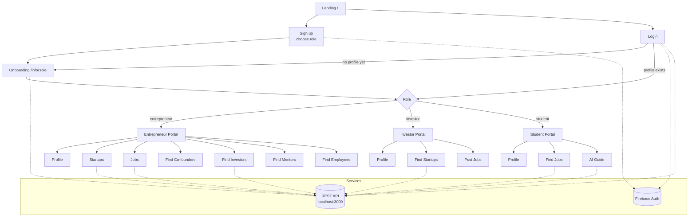

<div align="center">


# BizConnect

**One platform where entrepreneurs, investors and students find each other.**

[](https://react.dev/)
[](https://vitejs.dev/)
[](https://tailwindcss.com/)
[](https://daisyui.com/)
[](https://firebase.google.com/)
[](https://reactrouter.com/)
[](https://tanstack.com/query/v3)
[](https://axios-http.com/)
[](https://www.framer.com/motion/)

</div>

---

## Overview

Early-stage founders struggle to find co-founders, funding, mentors and hires. Investors want a filtered view of startups that are actually raising. Students want jobs and a clear idea of what to learn next. These groups rarely meet in one place.

BizConnect is the React frontend for a role-based networking platform that puts all three groups in a single app. Each user signs up with a role, completes a role-specific profile, and lands in a portal built around what that role needs.

## Features

### General

- Email and password sign up and login with **Firebase Authentication**
- Role chosen at sign up (Entrepreneur, Investor, Student) and resolved from the API at login
- First-time users are routed to a role-specific onboarding form (`/info/:role`); returning users go straight to their portal
- Shared portal layout: top bar with "Edit Info" and logout, plus a responsive sidebar drawer on mobile
- Animated landing page built with Framer Motion
- Toast notifications via `react-hot-toast`; multi-select skill and interest pickers via `react-select`

### Entrepreneur

| Feature | What it does |
| --- | --- |
| Profile | View industry, job title, skills, interests, experience, funds raised and partnership status |
| Startups | Add a startup (name, description, industry, funding raised, goal, current funding, fundraising status) and list your own startups |
| Jobs | Post a job (title, description, requirements, skills, company, deadline), list your postings and delete them |
| Find Co-founders | Browse potential partners, filter by skill and interest |
| Find Investors | Browse investors, filter by skill and interest, view details, contact by email |
| Find Mentors | Browse mentors, filter by skill and interest |
| Find Employees | Browse student profiles to hire from |

### Investor

| Feature | What it does |
| --- | --- |
| Profile | View interests, skills, experience, total investments, companies, and openness to investing or mentoring |
| Find Startups | Browse startups that are raising, filter by industry, contact the founder |
| Post Jobs | Post and manage job listings (shared Jobs page) |

### Student

| Feature | What it does |
| --- | --- |
| Profile | View major, graduation year, skills, interests, education and employment status |
| Find Jobs | Browse posted jobs, open details, contact the poster by email |
| AI Guide | Requests personalized suggested skills, courses, career path, career roadmap and skills roadmap from the backend, caches the result locally, and can regenerate on demand |

## How it fits together



## Tech Stack

| Layer | Tools |
| --- | --- |
| UI | React 18, Vite 5 |
| Styling | Tailwind CSS 3, DaisyUI 4 |
| Routing | React Router DOM 6 (`createBrowserRouter`) |
| Server state | React Query 3 |
| App state | React Context (`AuthProvider`) |
| Auth | Firebase Authentication (email and password) |
| HTTP | Axios (shared instance in `useAxiosPublic`) |
| UX | Framer Motion, react-hot-toast, react-select, React Icons |
| Tooling | ESLint, PostCSS, Autoprefixer |

## Routes

| Path | Page | Access |
| --- | --- | --- |
| `/` | Landing page | Public |
| `/login` | Login | Public |
| `/signup` | Sign up with role | Public |
| `/info/:role` | Role-specific onboarding and edit info | Signed in |
| `/entrepreneur`, `/entrepreneur/profile` | Entrepreneur profile | Entrepreneur |
| `/entrepreneur/startups` | Add and list startups | Entrepreneur |
| `/entrepreneur/jobs` | Post and manage jobs | Entrepreneur |
| `/entrepreneur/findPartners` | Find co-founders | Entrepreneur |
| `/entrepreneur/findInvestors` | Find investors | Entrepreneur |
| `/entrepreneur/findMentors` | Find mentors | Entrepreneur |
| `/entrepreneur/findEmployees` | Find employees | Entrepreneur |
| `/investor`, `/investor/profile` | Investor profile | Investor |
| `/investor/findStartups` | Find startups | Investor |
| `/investor/jobs` | Post and manage jobs | Investor |
| `/student`, `/student/profile` | Student profile | Student |
| `/student/findJobs` | Find jobs | Student |
| `/student/guidence` | AI Guide | Student |

> The "Access" column reflects which portal links to each route. Routes are not guarded in the router itself.

## Project Structure

```
BizConnect-frontend/
├── public/
│   ├── Home/              # Landing page imagery
│   ├── logo/              # BizConnect logo
│   ├── topBarJson/        # Sample JSON data
│   └── *.json             # Sample data (startups, jobs, investors, students, ...)
├── src/
│   ├── assets/            # Avatar SVGs used by ProfilePicture
│   ├── auth/
│   │   └── AuthProvider.jsx        # Firebase auth context
│   ├── components/
│   │   ├── ProfilePicture.jsx
│   │   ├── Sidebar.jsx             # Role-aware navigation drawer
│   │   └── TopBar.jsx              # Greeting, edit info, logout
│   ├── firebase/
│   │   └── firebase.config.js      # Firebase init from env vars
│   ├── hooks/
│   │   ├── useAxiosPublic.jsx      # Axios instance (base URL)
│   │   ├── useEntrepreneur.jsx
│   │   ├── useInvestor.jsx
│   │   ├── useRole.jsx
│   │   ├── useStudent.jsx
│   │   └── useUser.jsx
│   ├── pages/
│   │   ├── Entrepreneur/   # Portal, Profile, Startups, Jobs, Find*
│   │   ├── Investor/       # Portal, Profile, FindStartups, FindMentees
│   │   ├── Student/        # Portal, Profile, FindJobs, Guide
│   │   ├── Info.jsx        # Role-specific onboarding form
│   │   ├── Login.jsx
│   │   └── Signup.jsx
│   ├── App.jsx             # Landing page
│   └── main.jsx            # Router, QueryClient and AuthProvider setup
├── index.html
├── tailwind.config.js
├── postcss.config.js
└── vite.config.js
```

## Getting Started

### Prerequisites

- Node.js and npm
- A Firebase project with Email/Password sign-in enabled
- The BizConnect backend API running on `http://localhost:3000` (base URL set in `src/hooks/useAxiosPublic.jsx`)

### Install and run

```bash
git clone https://github.com/Tanvir-Chowdhury/BizConnect-frontend.git
cd BizConnect-frontend
npm install
npm run dev
```

### Scripts

| Command | Description |
| --- | --- |
| `npm run dev` | Start the Vite dev server |
| `npm run build` | Build for production into `dist/` |
| `npm run preview` | Preview the production build locally |
| `npm run lint` | Run ESLint on `.js` and `.jsx` files |

## Environment Variables

Create a `.env` file in the project root with your Firebase web app config. These are read in `src/firebase/firebase.config.js`.

| Variable | Purpose |
| --- | --- |
| `VITE_apiKey` | Firebase API key |
| `VITE_authDomain` | Firebase auth domain |
| `VITE_projectId` | Firebase project ID |
| `VITE_storageBucket` | Firebase storage bucket |
| `VITE_messagingSenderId` | Firebase messaging sender ID |
| `VITE_appId` | Firebase app ID |

## Author

**Md Tanvir Chowdhury**

[](https://github.com/Tanvir-Chowdhury)
[](https://tanvir-chowdhury.github.io/tanvir-portfolio/)
